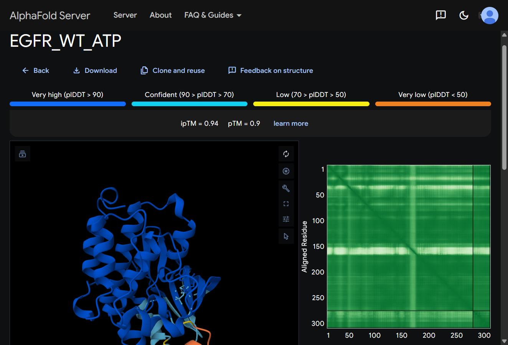
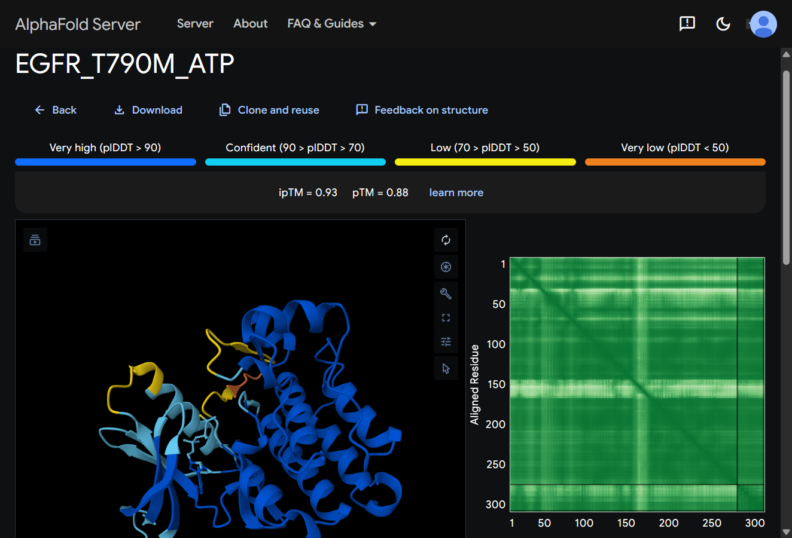

# EGFR T790M: AlphaFold 3 ATP-Bound Kinase Comparison

An educational, reproducible comparison of AlphaFold Server predictions for
the wild-type and T790M-mutant human EGFR kinase domain with ATP and magnesium.
The project compares model-confidence outputs and measures the
minimum heavy-atom distance from residue 79 of the modeled domain (full-length
EGFR residue 790) to ATP in each top-ranked structure.

> **AlphaFold Server output notice:** The structure, confidence, and screenshot
> files in this repository are AlphaFold Server output, subject to the
> [AlphaFold Server Output Terms of Use](https://alphafoldserver.com/output-terms).
> They are for non-commercial, theoretical modeling only; they are not for
> clinical use or automated ligand-binding prediction, docking, or screening.
> The original terms are retained in both result folders.

## Summary

| Comparison | Ranking score | pTM | ipTM | Clash flag | Model 0: residue 79 to ATP |
|---|---:|---:|---:|---:|---:|
| Wild type + ATP + Mg2+ | 0.930 (all five) | 0.900 (all five) | 0.940 (all five) | 0.0 (all five) | 3.43 Å |
| T790M + ATP + Mg2+ | 0.910–0.920 | 0.880 (all five) | 0.920–0.930 | 0.0 (all five) | 4.25 Å |

The distance is the shortest Euclidean distance between non-hydrogen atoms of
the target residue and ATP in model 0. It is a geometric measurement, not a
binding-energy estimate. The confidence scores and distances alone do not
establish that the mutation changes ATP binding or drug response.

### Confidence by ranked model

| Model | WT ranking | WT pTM | WT ipTM | T790M ranking | T790M pTM | T790M ipTM |
|---:|---:|---:|---:|---:|---:|---:|
| 0 | 0.930 | 0.900 | 0.940 | 0.920 | 0.880 | 0.930 |
| 1 | 0.930 | 0.900 | 0.940 | 0.920 | 0.880 | 0.930 |
| 2 | 0.930 | 0.900 | 0.940 | 0.920 | 0.880 | 0.920 |
| 3 | 0.930 | 0.900 | 0.940 | 0.910 | 0.880 | 0.920 |
| 4 | 0.930 | 0.900 | 0.940 | 0.910 | 0.880 | 0.920 |

## AlphaFold Server screenshots

These are direct screenshots of the completed job pages for the top-ranked
(`model_0`) predictions. Each page shows the job name and its pTM/ipTM scores,
the server's 3D predicted-structure viewer, and a predicted aligned error (PAE)
heatmap. The viewer is in its default orientation; neither screenshot selects
or labels residue 79, ATP, or Mg2+, so the pictures do not demonstrate a
specific residue-ligand contact.

The pTM/ipTM values are model-confidence metrics, not probabilities that a
biological interaction is true. The PAE heatmap shows the model's predicted
positional error across residue pairs; it is not experimental density. The
residue-to-ATP distances in the summary above were calculated separately from
the downloaded CIF coordinates by `measure_atp_pocket.py`, not estimated from
these images.

### Wild type (`EGFR_WT_ATP`, model 0)



The page reports **pTM = 0.90** and **ipTM = 0.94**. The structure coordinates
and confidence data are available in the
[model 0 CIF](EGFR_WT_ATP/fold_egfr_wt_atp_model_0.cif) and
[model 0 confidence JSON](EGFR_WT_ATP/fold_egfr_wt_atp_summary_confidences_0.json).

### T790M mutant (`EGFR_T790M_ATP`, model 0)



The page reports **pTM = 0.88** and **ipTM = 0.93**. The structure coordinates
and confidence data are available in the
[model 0 CIF](EGFR_T790M_ATP/fold_egfr_t790m_atp_model_0.cif) and
[model 0 confidence JSON](EGFR_T790M_ATP/fold_egfr_t790m_atp_summary_confidences_0.json).

## Workflow

1. `prep_sequences.py` downloads the human EGFR sequence (UniProt P00533),
   extracts residues 712–979 (268 amino acids), and creates the T790M
   substitution at position 79 of that fragment.
2. The wild-type and mutant sequences were submitted separately to
   [AlphaFold Server](https://alphafoldserver.com/) with ATP and Mg2+ as
   additional entities. Each job returned five ranked models.
3. `compare_confidences.py` reads the `summary_confidences` JSON files.
4. `measure_atp_pocket.py` uses Biopython's MMCIF parser to find model 0 and
   measure the closest non-hydrogen atom pair between residue 79 and ATP.

The included result files are the outputs of those two server jobs. Re-running
the sequence and analysis scripts is local; generating new structures requires
submitting new jobs to AlphaFold Server.

## Run the analysis scripts

Use Python 3 and install Biopython:

```powershell
python -m pip install biopython
python compare_confidences.py
python measure_atp_pocket.py
```

`prep_sequences.py` downloads the source FASTA from UniProt and requires an
internet connection:

```powershell
python prep_sequences.py
```

Run the commands from the repository root so the scripts can find the result
folders.

## Repository layout

```text
.
├── prep_sequences.py
├── compare_confidences.py
├── measure_atp_pocket.py
├── screenshots/
│   ├── egfr_wt_model_0.png
│   └── egfr_t790m_model_0.png
├── EGFR_WT_ATP/
│   ├── *_model_0.cif ... *_model_4.cif
│   ├── *_summary_confidences_*.json
│   └── terms_of_use.md
└── EGFR_T790M_ATP/
    ├── *_model_0.cif ... *_model_4.cif
    ├── *_summary_confidences_*.json
    └── terms_of_use.md
```

The result folders also contain the full model data, MSA, template files, and
job request JSONs downloaded from AlphaFold Server.

## Data sources and limitations

- **Sequence:** Human EGFR, UniProt accession [P00533](https://www.uniprot.org/uniprotkb/P00533/entry).
- **Predictions:** [AlphaFold Server](https://alphafoldserver.com/), generated
  for this project. The server output is provided as-is with varying
  confidence.
- **Scope:** This is a small in-silico exercise, not experimental validation,
  a clinical analysis, or evidence of drug resistance or binding affinity.

## Terms and licensing

AlphaFold Server files are provided under the terms linked above; see the
`terms_of_use.md` files in both result folders. Do not remove those notices
when redistributing the output. No separate license has been assigned to the
project scripts, so this repository does not grant additional reuse rights.
